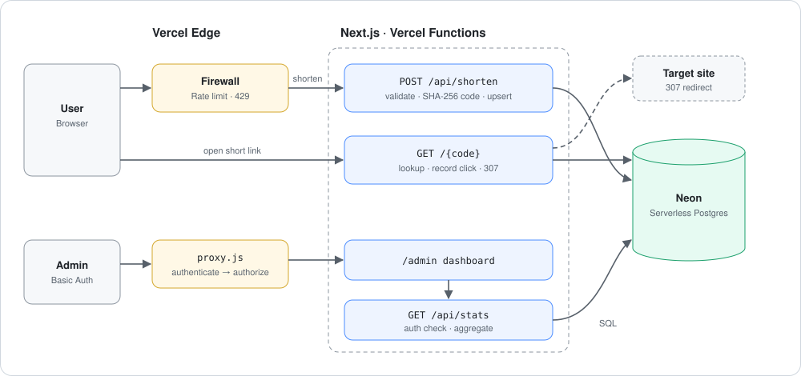

<div align="center">



# 🔗 Snip

**Next.js · Neon · Vercel로 만든 서버리스 URL 단축 서비스**

[](https://cloudcomputing-class-sources.vercel.app)


</div>

---

긴 URL을 붙여 넣으면 6자리 짧은 링크를 돌려주고, 그 링크로 들어오면 원래 주소로 보내 주는 작은 서비스입니다.
서버를 직접 띄우지 않고 **Vercel Functions + 서버리스 Postgres**만으로 저장, 리다이렉트, 사용량 통계, 관리자 보호, 요청 제한까지 구성해 보는 것이 목표였습니다.

## ✨ Features

- ✂️ **Deterministic short codes**: SHA-256 기반 6자리 코드. 같은 URL은 언제나 같은 링크가 되어 중복 저장이 없습니다.
- ↪️ **Fast redirects**: `307 Temporary Redirect` + `Cache-Control: no-store`로 매 요청이 서버를 거치도록 해 클릭을 빠짐없이 기록합니다.
- 🛡️ **Input hardening**: 빈 값, 2048자 초과, 잘못된 형식, `javascript:` 같은 위험한 스킴을 차단합니다.
- 🔁 **Loop protection**: 이 서비스 자신의 주소는 단축하지 않아 리다이렉트 루프를 막습니다.
- 📊 **Usage analytics**: 링크별 클릭 수와 최근 클릭 시간을 기록하고 `/admin` 대시보드에서 확인합니다.
- 🔐 **AuthN / AuthZ 분리**: "누구인가"(인증)와 "무엇을 할 수 있는가"(인가)를 별도 모듈로 나누고, 화면(`/admin`)과 데이터 API(`/api/stats`)를 각각 보호합니다.
- 🚦 **Rate limiting**: Vercel Firewall이 함수 앞단에서 `POST /api/shorten` 남용을 `429`로 차단합니다.

## 🧭 How it works

```text
POST /api/shorten ─▶ validate ─▶ SHA-256 → 6-char code ─▶ INSERT … ON CONFLICT DO NOTHING ─▶ 201 / 200
GET  /{code}      ─▶ lookup ─▶ record click (best-effort) ─▶ 307 Location: <original>
GET  /admin       ─▶ proxy.js: authenticate → authorize("admin:page") ─▶ dashboard
GET  /api/stats   ─▶ authenticate → authorize("stats:read") ─▶ aggregate SQL ─▶ JSON
```

**설계에서 신경 쓴 점**

- **멱등한 생성**: 코드가 URL에서 결정되므로 같은 요청을 몇 번 보내도 결과가 같고, `ON CONFLICT`로 경쟁 상태에서도 행이 하나만 남습니다.
- **가용성 우선**: 클릭 기록이 실패해도 리다이렉트는 그대로 수행합니다. 통계 일부를 잃는 편이 링크가 깨지는 것보다 낫기 때문입니다.
- **API도 직접 보호**: 관리자 화면만 막으면 `/api/stats`를 직접 호출해 데이터를 볼 수 있으므로, 데이터 API에서도 다시 인증하고 인가를 확인합니다.
- **스키마 자동 준비**: 첫 DB 접근 시 `CREATE TABLE IF NOT EXISTS`를 실행해 별도 마이그레이션 없이 바로 배포할 수 있습니다.

## 📡 API

```http
POST /api/shorten
Content-Type: application/json

{ "originalUrl": "https://www.google.com" }
```

```json
{
  "shortCode": "aB3xK9",
  "shortUrl": "https://<your-domain>/aB3xK9",
  "originalUrl": "https://www.google.com"
}
```

| Case | Status | `error.code` |
|---|:-:|---|
| 새 링크 생성 | `201` | |
| 이미 있는 링크 | `200` | |
| URL 누락 / 빈 값 | `400` | `MISSING_URL` |
| 형식 오류, 허용되지 않는 스킴 | `400` | `INVALID_URL` |
| 2048자 초과 | `400` | `URL_TOO_LONG` |
| 이 서비스 자신의 주소 | `400` | `SELF_REFERENCE_URL` |
| 요청 한도 초과 | `429` | |

| Endpoint | 설명 |
|---|---|
| `GET /{code}` | `307` 리다이렉트, 없는 코드는 `404` |
| `GET /api/stats` | 전체/링크별 사용량 JSON (관리자 인증 필요) |
| `GET /admin` | 사용량 대시보드 (관리자 인증 필요) |

## 🗂️ Project structure

```text
week01/hello-cloud-starter/      # 앱 루트 (Vercel Root Directory)
├─ app/
│  ├─ page.js                    # 메인 화면
│  ├─ [shortCode]/route.js       # 리다이렉트
│  ├─ admin/page.js              # 대시보드
│  └─ api/
│     ├─ shorten/route.js        # 링크 생성
│     └─ stats/route.js          # 통계 API
├─ lib/
│  ├─ db.js                      # Neon 연결, 스키마 준비, 저장/조회
│  ├─ stats.js                   # 클릭 기록, 집계 쿼리
│  ├─ auth.js                    # 인증 (Basic Auth)
│  └─ authorization.js           # 인가 (role → permission)
├─ proxy.js                      # /admin 요청 가드
└─ db/schema.sql
```

## 🚀 Getting started

```bash
cd week01/hello-cloud-starter
cp .env.example .env.local
npm install
npm run dev        # http://localhost:3000
```

| Env | 설명 |
|---|---|
| `DATABASE_URL` | Neon Postgres 연결 문자열 (pooled) |
| `ADMIN_PASSWORD` | `/admin` 로그인 비밀번호 (사용자 이름 `admin`) |

### Deploy on Vercel

1. 저장소를 Vercel에 Import하고 **Root Directory**를 `week01/hello-cloud-starter`로 지정합니다.
2. Storage(Marketplace)에서 **Neon**을 연결하면 `DATABASE_URL`이 자동으로 등록됩니다.
3. `ADMIN_PASSWORD`를 환경변수에 추가합니다.
4. (선택) Firewall에서 `POST /api/shorten`에 Rate Limit 규칙을 추가합니다.

## 🛠️ Tech stack

| Layer | Tech |
|---|---|
| Frontend | React 19, Next.js 16 App Router |
| Backend | Next.js Route Handlers on Vercel Functions (Node.js) |
| Database | Neon Serverless Postgres (`@neondatabase/serverless`) |
| Edge | Vercel Firewall (rate limiting), Next.js Proxy |
