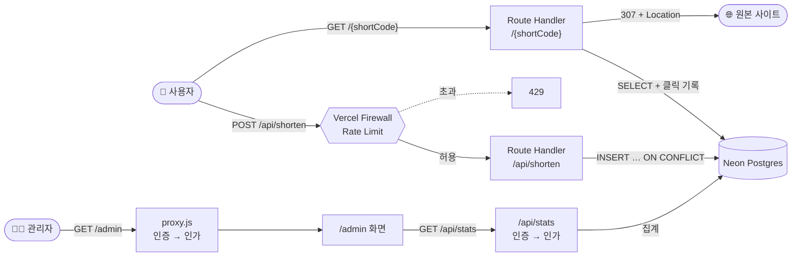

<div align="center">

# 🔗 URL Shortener on the Cloud

**서울사이버대학교 클라우드 컴퓨팅** 수업 1–7주차 실습을 하나로 완성한 서버리스 URL 단축 서비스

[](https://cloudcomputing-class-sources.vercel.app)


</div>

---

## ✨ 주요 기능

| | 기능 | 설명 |
|:-:|---|---|
| ✂️ | **URL 단축** | 긴 URL을 6자리 `shortCode`로 변환. 같은 URL은 항상 같은 코드 |
| ↪️ | **Redirect** | `/{shortCode}` 접속 시 `307` + `Cache-Control: no-store`로 원본 이동 |
| 🛡️ | **입력 검증** | 빈 값, 2048자 초과, 잘못된 형식, `javascript:` URL 차단 |
| 🔁 | **자기 참조 차단** | 이 서비스 자신의 주소는 단축 거부 (리다이렉트 루프 방지) |
| 📊 | **사용량 통계** | 클릭 수·최근 클릭 시간 기록, `/admin` 대시보드 |
| 🔐 | **인증·인가** | Basic Auth(인증) + 역할 기반 권한(인가)으로 `/admin`, `/api/stats` 보호 |
| 🚦 | **Rate Limit** | Vercel Firewall로 `POST /api/shorten` 요청 수 제한 (초과 시 `429`) |

## 🏗️ 아키텍처



## 🗓️ 주차별 구현 내용

| 주차 | 주제 | 구현 |
|:-:|---|---|
| 1 | 배포 파이프라인 | GitHub → Vercel 자동 배포 |
| 2 | 프론트엔드 입력 검증 | `validateUrl()` 클라이언트 검증 |
| 3 | Backend API | `POST /api/shorten`, HTTP Status Code (`201`/`400`/`500`) |
| 4 | 관리형 DB | Neon Postgres에 URL 매핑 저장 |
| 5 | 동적 라우트 | `GET /{shortCode}` → `307` / `404` |
| 6 | 관측성 | 클릭 기록, Runtime Logs, `/api/stats`, `/admin` |
| 7 | 보안 | 인증·인가 분리, API 보호, Firewall Rate Limit |

## 📡 API 한눈에 보기

```http
POST /api/shorten
Content-Type: application/json

{ "originalUrl": "https://www.google.com" }
```

```json
{
  "shortCode": "aB3xK9",
  "shortUrl": "https://cloudcomputing-class-sources.vercel.app/aB3xK9",
  "originalUrl": "https://www.google.com"
}
```

| 상황 | Status | `error.code` |
|---|:-:|---|
| 새 URL 단축 | `201` | — |
| 이미 단축된 URL | `200` | — |
| URL 누락·빈 문자열 | `400` | `MISSING_URL` |
| 형식 오류·`javascript:` 등 | `400` | `INVALID_URL` |
| 자기 서비스 주소 | `400` | `SELF_REFERENCE_URL` |
| 요청 한도 초과 | `429` | — |

전체 명세는 [프로젝트 README](week01/hello-cloud-starter/README.md#api)를 참고하세요.

## ✅ 자동 점검 결과

[과제 공개 점검 스크립트](https://github.com/alifewellspent/iscu_cloud_class/tree/main/assignment) 기준 **20 / 20점**

| ID | 항목 | 배점 | 결과 |
|:-:|---|:-:|:-:|
| T01 | `GET /` → 200 | 1 | ✅ |
| T02 | 단축 성공 201, shortCode/shortUrl/originalUrl | 3 | ✅ |
| T03 | 누락·빈 문자열 → 400 `MISSING_URL` | 1 | ✅ |
| T04 | 잘못된 URL·`javascript:` → 400 `INVALID_URL` | 1 | ✅ |
| T05 | 같은 URL → 같은 shortCode | 3 | ✅ |
| T06 | Redirect 307, Location 일치 | 2 | ✅ |
| T07 | 없는 shortCode → 404 | 1 | ✅ |
| T08 | Redirect `Cache-Control: no-store` | 1 | ✅ |
| T09 | 인증 없는 `/admin`, `/api/stats` → 401 | 2 | ✅ |
| T10 | 자기 서비스 URL 거부 → 400 | 3 | ✅ |
| T11 | 다른 Vercel 서비스 URL → 201 | 2 | ✅ |

## 📁 저장소 구조

```text
.
├─ week01/hello-cloud-starter/   ⭐ 완성된 과제 프로젝트 (Vercel Root Directory)
│  ├─ app/                       화면, Route Handler
│  ├─ lib/                       DB, 통계, 인증, 인가
│  ├─ proxy.js                   /admin 보호
│  └─ db/schema.sql              테이블 스키마
└─ week02 ~ week07/              주차별 실습 안내 문서와 제공 파일 (원본)
```

## 🚀 로컬 실행

```bash
cd week01/hello-cloud-starter
cp .env.example .env.local   # DATABASE_URL, ADMIN_PASSWORD 입력
npm install
npm run dev                  # http://localhost:3000
```

> `urls` 테이블은 첫 요청 시 자동으로 생성됩니다.

---

<div align="center">
<sub>서울사이버대학교 클라우드 컴퓨팅 수업 과제 · 실습 자료 원본: 강의 제공 저장소</sub>
</div>
